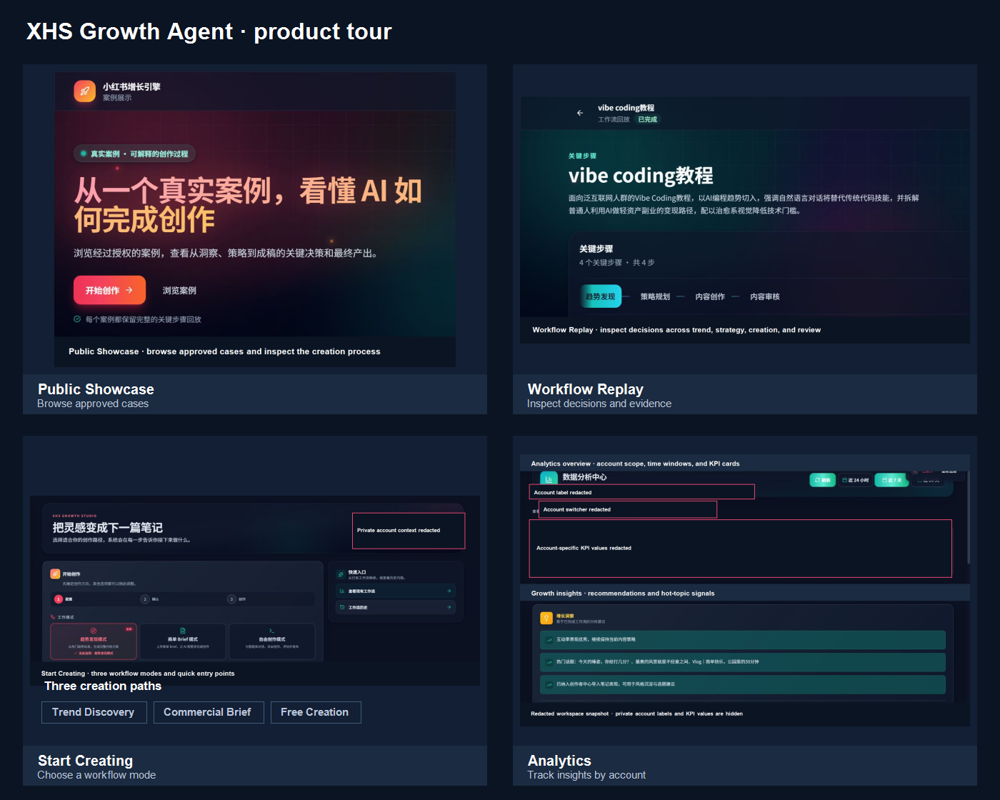
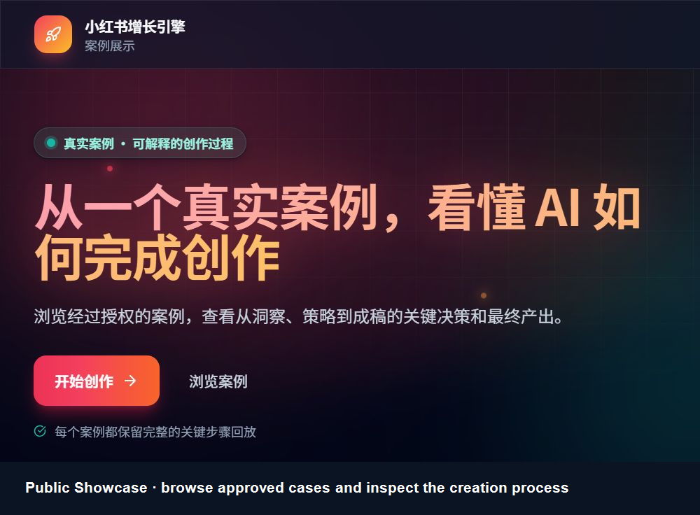
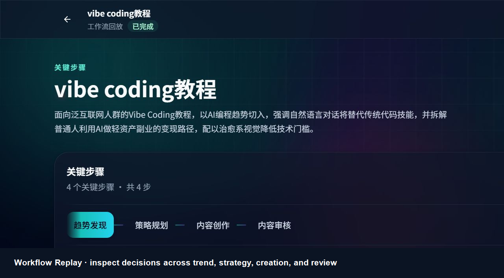
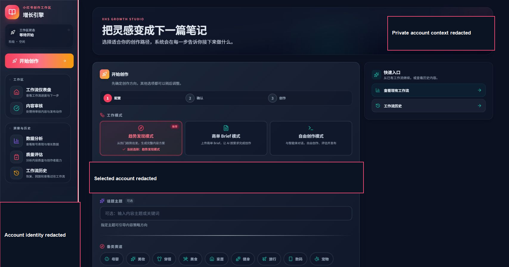
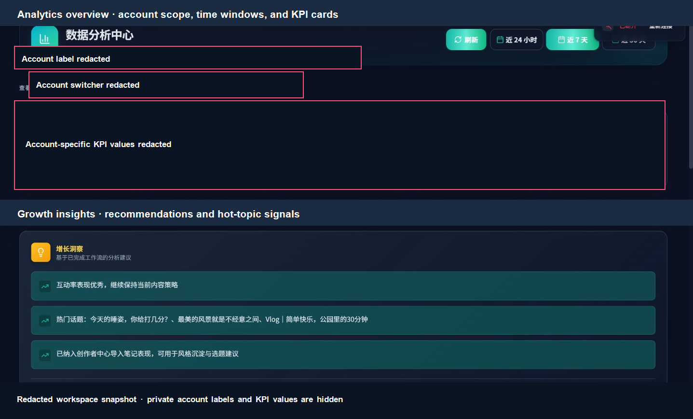

# 小红书增长引擎

面向小红书（Xiaohongshu / RedNote）的 AI 内容运营工作台，按 Kernel-centric 多智能体运行时构建，并在发布前保留人工审核边界。LangGraph 只负责执行任务图；状态、上下文、工具、调度和决策等系统职责由其下方的确定性内核层承担。

[English](./README.md) | [简体中文](./README.zh-CN.md)

[](https://xhs.jameryw.dev/)
[](./LICENSE)

> 从趋势发现到可审核、可发布的笔记产出，让证据、决策和中间结果都保持可见。

## 项目定位

小红书增长引擎把增长目标或创作 Brief 转化为可重复执行的内容工作流，将调研、定位、文案、视觉、质量检查、发布、数据分析和互动连接在一次可恢复的运行中，而不是分散在多个提示词和工具里。

适合需要以下能力的创作者、运营人员和团队：

- 将热点或 Brief 转化为清晰的选题角度；
- 产出完整笔记包：标题、正文、标签和视觉方向；
- 在任何内容发布前保留人工确认；
- 按账号查看历史工作流和表现；
- 通过 Web UI、CLI、API 或终端扩展使用同一套工作流。

## 在线产品展示

线上部署提供两个无需登录即可查看的只读页面：

- [打开公开案例展示](https://xhs.jameryw.dev/)：浏览已授权的案例和最终产出。
- [打开示例工作流回放](https://xhs.jameryw.dev/replay/case_c35a6559d23fd17cd832?from=%2F)：按步骤查看从趋势发现到内容审核的证据链。

“开始创作”会进入需要登录的工作区。公开页面用于了解产品和示例结果；创建、运行、审核或发布自己的工作流需要登录并配置凭据。

### 产品导览总览

<p align="center">
  
</p>

| 区域 | 线上入口 | 访问要求 | 展示内容 |
| --- | --- | --- | --- |
| 公开案例展示 | [`/`](https://xhs.jameryw.dev/) | 无需登录 | 浏览已授权案例并查看最终产出。 |
| 工作流回放 | [`/replay/:caseId`](https://xhs.jameryw.dev/replay/case_c35a6559d23fd17cd832?from=%2F) | 无需登录 | 按步骤查看从趋势发现到内容审核的证据链。 |
| 开始创作 | `/start` | 需要登录 | 选择创作路径、账号和目标，再进入对应工作区。 |
| 数据分析 | `/analytics` | 需要登录 | 切换账号范围、筛选时间窗口并查看增长洞察。 |

先看总览图，再通过下面的功能区块了解各个页面。每张图片都保留完整界面区域并标出清晰边界，打开 README 时可以直接读懂。

### 案例展示首页

<p align="center">
  
</p>

*截图于 2026-08-12 的线上公开部署。图片保留完整的 Showcase 主视觉区块，并移除了半截卡片和页面滚动延续内容。*

### 工作流回放

<p align="center">
  
</p>

*回放保留关键决策和生成结果；图片停在完整的阶段导航区块。*

线上公开案例当前展示了：

1. 趋势发现与受众洞察；
2. 策略规划与选题定位；
3. 内容创作，包括标题、长正文和视觉方向；
4. 内容审核，包括关键要点、标签、图片数量和配色方案。

### 登录后工作区功能区块截图

登录后的工作区在公开案例查看器之上增加了按账号隔离的创作与增长运营能力。以下功能区块截图来自 2026-08-12 的线上部署；账号名称、指标数值以及帖子/话题文本均已主动遮盖。每张图片都由完整界面区块构成，不再使用容易产生残缺的长页面滚动截图。

<p align="center">
  
</p>

*开始创作：选择趋势发现、商单 Brief 或自由创作。选择自由创作后，会先出现目标填写区，再进入 Agent 工作区。*

<p align="center">
  
</p>

*数据分析：切换账号范围、选择时间窗口、查看指标卡和增长洞察，并继续查看话题、图表、帖子明细和 CSV 导出。*

### 自由创作路径

自由创作现在会先完成一次清晰的引导，再进入对话工作区：

1. 在“开始创作”中选择目标小红书账号；
2. 输入创作目标、粗略想法或已有草稿，也可以直接套用示例提示；
3. 进入自由创作工作区后，目标会预填到可编辑输入框中，用户确认发送前不会触发智能体；
4. 继续通过对话、`/drafts`、`/evaluate`、`/analytics`、修改和发布完成按账号隔离的创作闭环。

目标和账号会一起带入工作区，因此自由模式生成的草稿和后续洞察会归属于用户刚刚选择的创作者账号。

发布后，`/analytics <id>` 会把互动快照保存到草稿上，最新浏览/点赞/收藏在 `/draft <id>` 和历史页的“自由草稿”标签页中随时可见，无需重新从小红书拉取。多次采集会形成最近 10 次的趋势序列；草稿详情与历史徽标都会显示浏览量较上次的变化。

### 登录后工作区导览

登录后，工作区按账号隔离，覆盖创作、审核、数据分析和账号运营：

| 页面 | 可以做什么 |
| --- | --- |
| 开始创作 | 选择趋势发现、商单 Brief 或自由创作；选择账号；自由创作还会把可编辑目标带入 Agent 工作区。 |
| 工作流仪表盘 | 跟踪实时工作流、查看阶段输出、恢复下一步行动，并继续中断运行。 |
| 内容审核 | 对比生成的笔记包，提交通过/拒绝/修改意见，并明确保留发布边界。 |
| 数据分析 | 切换账号，选择近 24 小时/7 天/30 天，查看指标卡、增长洞察、热门话题、图表、帖子明细和 CSV 导出。 |
| 质量评估 | 查看发布后表现、RQGM 内容评审趋势、样本可信度、质量维度和已评估工作流。 |
| 工作流历史 | 按账号浏览历史工作流，在账号间切换而不改变当前工作区，并恢复或回放历史运行。 |
| 设置 | 管理管控台用户、小红书账号、扫码/浏览器登录态、创作者中心数据绑定、模型/Ripple/向量配置和公开页体验监控。 |
| 帮助中心 | 查看 FAQ、打开键盘快捷键并提交产品反馈。 |

以上能力清单来自 2026-08-12 对登录后工作区的实际查看。账号名称、真实指标、帖子文本和工作流记录会随部署变化，因此不会提交到仓库；仓库保留公开 Showcase/Replay 截图和已脱敏的工作区功能区块作为可分享证据。

### 从输入到产出

启用相应集成后，一次运行会沿着以下路径，从输入经过工作区步骤，留下可检查的产出：

| 输入或信号 | 工作区步骤 | 可以检查的产出 |
| --- | --- | --- |
| 自由创作目标 | 开始创作 → Agent 工作区 | 可编辑输入框、选中账号和明确的发送决策 |
| 热点或增长 Brief | 开始创作 | 账号、主题、垂类和启动就绪状态 |
| 调研信号 | 趋势侦察 + 内容策略 | 证据、受众洞察、定位和发布时间判断 |
| 创作方向 | 文案创作 + 视觉设计 | 标题、正文、标签、CTA 和视觉方案 |
| 人工决策 | 内容审核 | 发布前的通过、拒绝或修改意见 |
| 已通过的笔记包 | 质量评估 + 内容发布 | 质量结果、发布请求，以及可选的实验/定时发布扩展点 |
| 发布后反馈 | 数据分析 + 用户互动 | 指标、话题模式、帖子明细和下一轮创作信号 |

## 产品能力

| 能力 | 作用 | 主要入口 |
| --- | --- | --- |
| 趋势侦察 | 发现热点、关键词、受众信号和竞品内容模式。 | Trend Scout、公开回放 |
| 内容策略 | 将热点或 Brief 转化为选题角度、受众、时机和增长假设。 | Content Strategist、Dashboard |
| 文案创作 | 生成标题、正文、标签、CTA 和修订版本。 | Copywriter、Review |
| 视觉设计 | 根据小红书内容模式推荐封面概念、布局、配色、风格和图片提示词。 | Visual Designer、Review |
| 人工审核 | 在审核门暂停，由人工通过、拒绝或提出修改意见。 | Review 工作台 |
| 质量评估 | 人工通过后增加 AI 质量检查，将不合格草稿路由回修订流程。 | Evaluation、工作流图 |
| 内容发布 | 对接小红书发布器，并提供 A/B 版本和定时发布扩展点。 | Publisher 工具、API |
| 数据分析 | 读取表现、成本、互动和内容模式，为下一轮创作提供依据。 | Analytics、Analyst |
| 用户互动 | 通过选定账号会话支持评论回复和私信流程。 | Engagement 工具 |
| 账号运营 | 将账号上下文、浏览器会话和历史记录隔离到对应创作者账号。 | Settings、账号控制 |
| Creator Agent 决策核心 | 将创作者身份、判断政策和证据转为可复现的个性化决策，并沉淀关系记忆与待审核学习信号。 | `/api/creator-agent`、[设计说明](docs/creator-agent.md) |
| 长期记忆 | 可选的 hy-memory 记忆引擎，跨会话召回账号画像（chat 场景）与运营经验（working 场景），并由 Analyst 尽力回写；lite（纯向量）/ pro（LLM 抽取）双模式，默认关闭，故障时绝不拖垮主链路。 | Analyst、Content Strategist、[集成说明](docs/hy-memory.md) |

### 端到端流程

```text
热点 / Brief
    ↓
趋势侦察 → 内容策略 → 文案创作 + 视觉设计
                         ↓
                    人工审核门
                         ↓
                    AI 质量评估
                    ↙          ↘
                 修订          发布
                               ↓
                       数据分析 + 用户互动
```

工作流支持恢复，并会暴露状态、中间结果、审核决策和性能日志。审核门是明确的产品边界：智能体可以准备和评估内容，但发布动作仍然可见、可控。发布会先经过确定性策略引擎和人工确认，再由 Tool Gateway 执行，每次执行都会返回不可变回执。

**合规默认偏安全：** 已删除伪造 HTTP 签名（改为明确的 `signature_unavailable`，不静默空结果）；防检测伪装（stealth / webdriver 隐藏）已硬删除；能否发布由确定性失败模式判定器 + 审计（`publish_eligibility`）决定，不交给 LLM 自评；`AUTO_APPROVE_LOW_RISK` 与 `auto_publish` 不可同时开启；私信默认仅回复入站白名单并有日配额；LLM 评估前先做确定性违禁词扫描；商单 brief 发布前须勾选披露确认。详见 [docs/security.md](./docs/security.md)。

## Web 工作区

Vue 3 前端围绕创作、审核、增长和账号运营组织：

| 页面 | 路径 | 作用 |
| --- | --- | --- |
| 公开案例展示 | `/` | 无需登录查看公开案例和最终产出。 |
| 公开工作流回放 | `/replay/:caseId` | 回放公开案例的关键决策和证据。 |
| 开始创作 | `/start` | 选择趋势发现、商单 Brief 或自由创作，配置账号/主题/垂类，或把自由创作目标带入 Agent 工作区。需要登录。 |
| 工作台 | `/dashboard/:threadId?` | 查看实时状态、进度、阶段输出、恢复信息和下一步行动。 |
| 内容审核 | `/review/:threadId?` | 发布前预览、通过、拒绝或修改内容。 |
| 数据分析 | `/analytics` | 查看账号指标、时间范围、增长洞察、热门话题、图表、帖子明细和 CSV 导出。 |
| 质量评估 | `/evaluation` | 查看发布后表现、RQGM 评审趋势、样本可信度和工作流质量结果。 |
| 历史记录 | `/history` | 切换账号范围，恢复、查看和回放历史工作流。 |
| 设置 | `/settings` | 管理管控台用户、小红书账号/登录态、创作者中心数据、系统配置和公开页监控。 |
| 帮助中心 | `/help` | 查看 FAQ、键盘快捷键、引导和反馈入口。 |
| 自由创作 TUI | `/tui?mode=free` | 使用带草稿和帮助快捷操作的终端式创作工作区。 |

公开案例展示和回放是安全的浏览入口；私有工作区、账号会话、模型密钥和发布操作仍由登录与本地配置保护。

## 技术架构

### 运行时

- **后端：** Python 3.11+、FastAPI、LangGraph、Pydantic、Typer、Uvicorn
- **前端：** Vue 3、Vite、Pinia、Vue Router、Tailwind CSS、ECharts、xterm.js
- **持久化：** 开发环境使用 SQLite/内存检查点，生产环境使用 PostgreSQL 和 Redis。工作流遥测写入 `workflow_events` 表，持久调度走执行租约，都不在检查点里。
- **浏览器自动化：** Playwright，支持按账号隔离浏览器/CDP 会话
- **可选预测引擎：** Ripple CAS，通过 HTTP 集成
- **可选长期记忆：** [hy-memory](./docs/hy-memory.md)，默认关闭；跨会话召回账号画像与运营经验，引擎故障时降级为空结果、绝不中断运行。chat 场景事实落向量库，working 场景轨迹落 SDK 独立的 coding store —— `list_memories` 会聚合两个存储的读面（working 条目带 `store: "working"` 标记）。

### 内核分层

LangGraph 只执行任务图，系统职责由其下方的确定性内核层承担：

| 分层 | 位置 | 职责 |
| --- | --- | --- |
| RuntimeState / Artifact / Event 三层 | `backend/state/` | 小而有界的检查点；大正文进 artifact store；遥测进 event store；所有读面收口 hydration |
| Context Compiler | `backend/context/` | recall → rerank → dedup → freshness → token budget → compile；L0–L5 稳定 prompt 分层 |
| Tool Runtime | `backend/tools/runtime/` | Agent 只声明能力；超时、重试、权限、限流、错误与追踪在网关统一收口 |
| Durable Scheduler | `backend/db/execution_leases.py`、`backend/api/routes/_takeover.py` | 租约获取/心跳/提交/过期，重启后安全接管 |
| Decision / Action | `backend/creator_agent/policy.py`、`backend/agents/nodes/publish_gate.py` | PublishIntent → 确定性策略 → 人工确认 → 执行器 → 不可变回执 |

设计说明：[架构约定](./docs/architecture-conventions.md)、[任务图规划](./docs/planning.md)、[上下文编译器基线](./docs/context-compiler-baseline.md)、[工具运行时](./docs/tool-runtime.md)、[执行平面](./docs/execution-plane.md)、[发布动作协议](./docs/publish-action-protocol.md)、[结果学习](./docs/outcome-learning.md)。

### Agent 与工具层

| Agent | 代表性工具 | 产出 |
| --- | --- | --- |
| `trend_scout` | `xhs_trending`、`keyword_monitor`、`competitor_analyzer` | 趋势和受众信号 |
| `content_strategist` | `topic_scorer`、`timing_optimizer`、`ripple_predict` | 角度、时机和定位 |
| `copywriter` | `hashtag_researcher`、`title_generator` | 笔记文案和版本 |
| `visual_designer` | `image_prompt_generator`、`layout_recommender` | 封面和视觉方案 |
| `review_gate` | Human-in-the-loop interrupt | 审核或修改意见 |
| `publisher` | `xhs_publisher`、`ab_test_manager`、`post_scheduler` | 策略门控发布：意图 → 确定性策略 → 人工确认 → 网关执行 + 不可变回执 |
| `analyst` | `analytics_reader`、`pattern_detector`、`report_generator` | 表现洞察 |
| `engagement` | `comment_replier`、`dm_handler` | 账号互动动作 |

### 模型路由

系统按任务类型选择模型，提供商通过环境变量配置。当前默认（见 `backend/config/models.py`）通用任务使用 MiMo V2.6 Flash，窄任务使用 DeepSeek V4 Flash；MiMo 遇到可重试故障且重试耗尽后，会切换到 DeepSeek：

| 任务 | 项目默认路由 |
| --- | --- |
| 路由、趋势侦察、策略、文案、视觉规划、分析、发布、用户互动、内容分析、版本生成、简报分析、拍摄计划、质量评估 | `mimo-v2.6-flash` |
| 润色（`TaskType.POLISH`）、Mock 生成（`TaskType.MOCK_GEN`）、爆款匹配（`TaskType.VIRAL_MATCHING`） | `deepseek-v4-flash` |

只有限流、服务端、网络或超时错误在 MiMo 重试耗尽后才会切换；鉴权和无效请求错误会直接返回。启用主模型和备用模型需配置 `XIAOMIMIMO_API_KEY` 与 `DEEPSEEK_API_KEY`。

## 安装

```bash
git clone https://github.com/JameryW/XhsGrowthAgent.git
cd XhsGrowthAgent

pip install -e ".[dev,browser]"
playwright install
```

复制环境变量示例，并至少配置一个 LLM 提供商密钥：

```bash
cp .env.example .env
```

### 主要配置

| 变量 | 用途 | 要求 |
| --- | --- | --- |
| `ANTHROPIC_API_KEY` | Anthropic 模型 | 至少配置一个模型提供商 |
| `OPENAI_API_KEY` | OpenAI 模型 | 至少配置一个模型提供商 |
| `DEEPSEEK_API_KEY` | DeepSeek 路由和趋势侦察 | 可选，若改用其他路由 |
| `DASHSCOPE_API_KEY` | Alibaba/Qwen 发布路由 | 可选，若改用其他路由 |
| `RIPPLE_BASE_URL` | Ripple CAS 服务地址 | 可选 |
| `RIPPLE_API_TOKEN` | Ripple CAS 令牌 | 可选 |
| `HYMEMORY_ENABLED` | hy-memory 长期记忆引擎 | 可选（默认关闭，见[集成说明](docs/hy-memory.md)） |
| `POSTGRES_URI` | 生产检查点/数据库连接 | 生产环境 |
| `REDIS_URI` | 生产缓存和协同 | 生产环境 |

完整环境变量见 [docs/configuration.md](./docs/configuration.md)，密钥和账号会话安全见 [docs/security.md](./docs/security.md)。

## 快速开始

### 使用 CLI 运行工作流

```bash
# 不调用外部 API，验证工作流
xhs-growth run --dry-run

# 指定账号和起始阶段
xhs-growth run --account-id my_account --phase scouting

# 查看工作流并恢复中断运行
xhs-growth status <thread_id>
xhs-growth resume <thread_id>
```

### 启动 Web/API 服务

```bash
xhs-growth serve --port 8000
```

前端开发：

```bash
cd frontend
npm install
npm run dev

# 生产构建和检查
npm run build
npm run type-check
npm run test:run
npm run i18n:check
```

### Python API

```python
from backend.graph.builder import compile_graph_dev

graph = await compile_graph_dev()
config = {"configurable": {"thread_id": "demo-thread"}}

result = await graph.ainvoke(
    {"phase": "scouting", "account_id": "my_account"},
    config,
)
```

HTTP 接口、请求/响应示例、审核提交、数据分析和健康检查见 [docs/api-reference.md](./docs/api-reference.md)。

## Ripple CAS 集成

项目通过 fork 版本 [JameryW/Ripple](https://github.com/JameryW/Ripple) 获取内容预测信号。该 fork 增加了 provider 抽象、顶层 `provider_insights`、分阶段超时和项目使用的 `job.timed_out` 事件。

支持健康检查与 ping、模拟任务提交/查询、紧凑日志、JSON 输出、报告、事件流和取消操作：

```bash
git clone https://github.com/JameryW/Ripple.git
cd Ripple
podman build -t ripple-service:local -f deploy/docker/Dockerfile .
podman run -d --name ripple-service \
  -p 127.0.0.1:8080:8080 \
  -e RIPPLE_API_TOKEN=your_token \
  localhost/ripple-service:local

RIPPLE_BASE_URL=http://127.0.0.1:8080
RIPPLE_API_TOKEN=your_token
RIPPLE_ENABLED=true
```

## oh-my-pi 扩展

可选的 [oh-my-pi](https://github.com/can1357/oh-my-pi) 扩展可以在终端 Agent 中使用同一套工作流：

```bash
cd backend/omp/extensions/xhsagent-ext
npm install
export XHS_AGENT_API_BASE=http://localhost:8000
```

使用 `/xhs [topic]` 开始创作，使用 `/xhs-review` 审核待处理内容；扩展还提供开始、查询、暂停、恢复、取消、通过和拒绝工具。

## 视觉推荐引擎

视觉层使用数据驱动的推荐引擎：从小红书帖子中提取模式，按场景保存并过期，再依据内容类型、兼容性、热度、配色和趋势分数推荐布局与风格。

支持美食、旅行、穿搭、美妆、生活方式、健身和家居等场景，推荐模型位于 `backend/services/visual_analysis.py`，由视觉设计工作流经 `backend/tools/content/` 调用。

## 2026-11 架构升级

本轮升级把 2026 年小红书算法与社媒智能体论文的公开结论落成可复用、可测试的确定性内核模块；新能力随对应节点或参数默认生效，但保留既有契约（dry-run 仍返回 `mock_published`、评估结果新增字段而非替换、上下文惩罚设 0 可恢复旧的尾部裁剪）。

| 模块 | 位置 | 能力 |
| --- | --- | --- |
| Collect-First 预测 | `backend/tools/analysis/collect_first.py` | 四头 `log(1+y)` 预测（阅读/点赞/收藏/评论）+ 64 维文本表示 + 指数核 Hawkes 拟合与 14 天扩散曲线 + 固定种子配对时间/格式反事实；strategist 按预测收藏降序选主推；≥8 条已发布笔记可拟合账号级 log 空间校准（斜率/截距/R²），只校正先验、不重训特征权重 |
| 搜索质量门 | `backend/services/quality_gate.py` | SearchLLM 式 Layer I Soft-AND 底线门（合规/文案/商单语气）+ `geo_readiness` 搜索 GEO 就绪度；评估器输出 `quality_gate` 与 `search_geo` |
| 去 AI 味 | `backend/tools/content/plad.py`、`backend/tools/content/novelty.py` | 31 项 PLAD 心理语言学特征与结构化约束；0.82 余弦阈值的账号历史新颖度惩罚 |
| 记忆效用门 | `backend/memory/hy/promotion.py` | Outcome-Verified Epistemic Gate：收藏率或阅读量达到近 10 篇中位数 1.2×、或人工批准，才晋升 `verified_pattern`；否则记入 `negative_pitfalls` |
| 上下文预算 | `backend/context/compiler.py` | Token 重叠率与边际效用惩罚（`XHS_CONTEXT_OVERLAP_PENALTY`，默认 0.15，设 0 恢复旧的尾部裁剪） |
| 优雅排水 | `backend/db/execution_leases.py`、`backend/api/app.py` | `SIGTERM` 时停止获取新租约、限时等待在途任务、释放本实例全部租约；启动时对 UNKNOWN 发布做读回核实，避免重复发布 |
| 视觉时间衰减 | `backend/services/visual_analysis.py` | 14 天半衰期指数衰减权重（`2 ** (-Δt/14)`），近期封面/版面优先 |
| Dry-run 状态仿真 | `backend/services/context_tree_sim.py` | MCP-Persona 式 `User → Account → Draft/Post → Comment/DM` 有状态仿真，覆盖标题/正文长度、违禁词、会话、签名、频控与私信配额；已发布笔记可追加 `AnalyticsSnapshot` 互动快照 |

### 第 2 期：深水区契约

| 模块 | 位置 | 能力 |
| --- | --- | --- |
| 外部内容护栏 | `backend/tools/runtime/untrusted.py`、`gateway.py` | 趋势/关键词/竞品/搜索/选题工具标记 `external_content=True`；结果清洗零宽字符与“忽略指令/自动批准/改价”等提示注入，`ToolResult.untrusted` 透传给 Agent |
| 结果学习门禁 | `backend/services/outcome_learning.py`、`creator_stats/analyze.py` | 少于 48 小时的笔记不计入；按最近 10 篇成熟笔记的收藏中位数计算年龄校准优势，成熟笔记≥3 且平均优势>0 才可生成晋升信号，并附 Spearman 秩相关工具 |
| Judge 身份与校准 | `backend/agents/evaluator.py`、`backend/services/judge_calibration.py` | 每条 RQGM 结果记录 `judge_model_id`；按模型最近 50 次评分做均值/标准差标准化，避免限流切换造成趋势跳变 |
| 前缀缓存断点 | `backend/context/models.py` | `cache_prefix`/`cache_tail`/`cache_prefix_token_cost` 与可选的 `render_with_cache_breakpoint()`；L0–L2 保持稳定，`render()` 字节不变 |
| 私信资格门 | `backend/services/dm_qualification.py`、`xhs_engagement.py` | 五槽位 FSM（日期/租期/车型/预算/区域）+ 外链/联系方式/未核实报价/越权承诺拦截；`dm_handler` 可选 `qualification_state` 与 `known_prices`，不通过时不写效果账本 |
| 周复盘 Bandit | `backend/services/experiment_bandit.py`、`tools/xhs/publisher.py` | 滑动窗口 UCB + Wilson 下界、Canary 变体；`ab_test_manager` 返回 `bandit`/`canary` 决策，仍由人工确认晋升 |

这些模块是工程近似：结果学习使用确定性中位数门槛而非完整因果模型；Bandit 只做离线排序，不自动改线上流量；私信 FSM 的槽位抽取基于正则，不替代人工确认。

### 第 3–6 期：前沿契约

| 模块 | 位置 | 能力 |
| --- | --- | --- |
| 发布前多模态门（13–18） | `backend/services/content_launch.py` | 图文互补/缩略图可读性/垂类美学协同评分（`visual_designer` 已接）；TagLLM 三层 5–8 标签（`copywriter` 已接）；review 风险信号条（evaluator 已接）；Playwright/CDP 会话三态熔断（`xhs.publisher` 已接）；根因分类与单篇 Token 成本（`_runner` 已接）；SSE 统一 `sse_event_frame` |
| 时间与执行（19–24） | `backend/services/temporal_contracts.py`、`backend/db/draft_analytics.py` | 草稿 CAS 版本与独立追加的 `DraftAnalyticsSnapshot`（free API 已接）；24h/7d 正余弦编码与 48 槽位（topic_scorer 已输出 `time_pop`）；自抑制 Hawkes 核（topic_scorer 的 `inhibition` 已接）；`compile_jit_subgraph` 模式计划 + `build_jit_graph(mode)`/`compile_graph_dev(mode)` 真实 mode-specific 子图（CLI `--jit-mode`）；商单 Brief 契约字段校验；A/B/C 叙事锚点；Ripple 超时 partial 抢救 + 可选本地回归兜底 |
| 评估与生成（25–30） | `backend/services/evaluation_contracts.py` | 能力路由（`XHS_CAPABILITY_ROUTING=1` 且配置 `XIAOMIMIMO_API_KEY` 时创意任务走 MiMo，默认仍走 magpie）；GRS/GAR 组内相对评审（多版本评估已输出 `groupwise`）；PTGS 温度（copywriter 在有评估结果时按 s_max/PLAD 绑定 `temperature`，prompted 路由生效）；APMD 锚点重置与香农熵（creator_stats 持久化 anchor 并输出 `policy_reset`）；真实渲染封面安全区/对比度/缩略图检查（publisher 已接）；SWA 冻结前缀 + ≤160 token 尾部锚点（copywriter 已接） |
| 分发与回放（31–36） | `backend/services/distribution_contracts.py` | EGMF 曝光/限流诊断与可信度（creator_stats 已接）；trend/brief/free 场景权重（evaluator 输出 `scenario_scores`）；多图滑动留存弧与 AVTP Token 分配（`visual_designer` 已接）；粉赞比 BreakoutLift；FanRelationStore 原子 JSON 持久化（DM 成功后写入画像并返回破冰文案）；`/replay` 确定性脱敏 bundle（public API 已接） |

上述模块已完成低风险生产接线（表中标注“已接”）；`compile_jit_subgraph` 仍是带图节点校验的模式计划，`build_jit_graph(mode)` 则按 `export_plan(mode)` 的节点/边生成真正可编译的独立子图；PTGS 已由 copywriter 在提示词约束路径上绑定，但 native structured 路由仍使用模型默认温度；APMD 已由 creator_stats 持久化 anchor 并输出重置决定，SAIM 场景权重由 evaluator 输出，但都不改变默认发布决策；模型能力路由仅作为显式 opt-in，默认发布资格契约未被改动。

两项边界是刻意保留的，而不是未完成项：其一，生产 API 默认仍编译完整图，运行期模式差异由 LangGraph 条件边处理；`--jit-mode`/`compile_graph_dev(mode)` 是显式选择独立子图的入口，独立子图只保留计划内节点，供批处理/调试按需使用。其二，仓库策略是所有 LLM 出网统一经 magpie（见 `CLAUDE.md`），`XHS_CAPABILITY_ROUTING=1` 只会在 `XIAOMIMIMO_API_KEY` 存在时把创意任务切到 MiMo，prefill/视觉仍由 magpie 的 DeepSeek 上游承担；没有对应 provider 凭据时保持原路由。

## 测试与开发

```bash
# 后端
pytest
ruff check .
ruff format --check .
mypy backend

# 前端
cd frontend
npm run test:run
npm run type-check
npm run i18n:check
npm run build
```

hy-memory 集成附带 40 个单测（bridge + agent 接线，默认关闭——无需引擎即可跑），并有一套 63 项断言的端到端功能测试；依赖已升级到 hy-memory 2.0.16，接入方式与引擎已知行为见[集成说明](./docs/hy-memory.md)。

更多文档：

- [架构约定](./docs/architecture-conventions.md)
- [任务图规划](./docs/planning.md)
- [上下文编译器基线](./docs/context-compiler-baseline.md)
- [工具运行时](./docs/tool-runtime.md)
- [结果学习](./docs/outcome-learning.md)
- [发布动作协议](./docs/publish-action-protocol.md)
- [测试指南](./docs/testing-guide.md)
- [前端 UX 与交互规范](./docs/frontend-ux-optimization.md)
- [部署指南](./docs/deployment.md)
- [执行平面：租约 / 接管 / 边界](./docs/execution-plane.md)
- [Agent OS 升级：差距审计与路线](./docs/agent-os-upgrade-2026q4.md)
- [hy-memory 集成](./docs/hy-memory.md)
- [配置参考](./docs/configuration.md)
- [API 参考](./docs/api-reference.md)
- [安全注意事项](./docs/security.md)
- [贡献指南](./CONTRIBUTING.md)

## 许可证

MIT License，详见 [LICENSE](./LICENSE)。
